<!-- ============ HEADER ============ -->


<p align="center">
  <a href="https://git.io/typing-svg">
    
  </a>
</p>

<p align="center">
  <a href="https://om-satodiya.vercel.app"></a>
  <a href="https://linkedin.com/in/om-satodiya9609"></a>
  <a href="mailto:omsatodiya96@gmail.com"></a>
  <a href="https://leetcode.com/u/omsatodiya"></a>
  <a href="https://codeforces.com/profile/omsatodiya"></a>
</p>

<p align="center">
  
  <a href="https://wakatime.com/@45c5f064-3af8-47f3-9170-3dcadb77f9d5"></a>
</p>

<!-- ============ ABOUT ============ -->
## `$ whoami`

```yaml
name:      Om Satodiya
role:      Final-year B.Tech CS @ SVNIT Surat (2027)
focus:     backend systems · async job pipelines · RAG · multi-tenant SaaS
latest:    TenantOpsBench — grading LLM agents on real DB state, not vibes
community: ACM Student Chapter & GDSC @ SVNIT · Amazon ML Summer School '26
cp:        LeetCode 1809 peak · Codeforces 1344 peak
ask_me:    Postgres RLS, BullMQ, why your RAG retrieves the wrong chunk
```

<!-- ============ BUILD LOG ============ -->
## 📦 Build Log

> Things I've shipped, newest first. Team size listed honestly — my part is what's described.

| | Project | What it is | Stack |
|:-:|---|---|---|
| 🧪 | **[TenantOpsBench](https://github.com/omsatodiya/tenantopsbench)** <br><sub>solo</sub> | Benchmark that drops LLM agents into a mock multi-tenant SaaS (billing, job queue, helpdesk, audit log) and grades their ticket fixes by **final database state** — every ticket hides a trap that naive fixes fall into. | Python · FastAPI · Postgres RLS · Docker · pytest |
| 🏘️ | **[ConnectIQ](https://github.com/omsatodiya/AI-Manthan)** <br><sub>hackathon · team of 4</sub> | Multi-tenant LLM community platform. I built the user matchmaking engine, the hybrid RAG assistant, and tenant isolation with real Postgres RLS policies. | Next.js · Postgres · Groq (Llama 3.3 70B) |
| 💸 | **[FinBridge](https://github.com/omsatodiya/Finbridge---HTT3)** <br><sub>hackathon · team of 3</sub> | Offline-first field-agent PWA. I built async jobs on BullMQ/Redis, a multimodal sentiment pipeline (RoBERTa INT8-ONNX + Wav2Vec2), and IndexedDB sync that survives flaky reconnects. | BullMQ · Redis · FastAPI · Dexie · ONNX |
| 🔎 | **[Distributed RAG Core](https://github.com/omsatodiya/Distributed-RAG)** <br><sub>team</sub> | RAG split into ingestion and query services. I owned the embedding worker, the Qdrant vector-store service with search cache, and the query service (retrieval, reranking, multi-provider dispatch). | Django · Qdrant · Groq / Ollama / Gemini |

<!-- ============ STACK ============ -->
## 🧰 Toolbox

<p align="center">
  <b>Backend</b><br>
  
  <br><br>
  <b>Data & Infra</b><br>
  
  <br><br>
  <b>Frontend</b><br>
  
  <br><br>
  <b>AI / ML</b><br>
  
</p>

<!-- ============ STATS ============ -->
## 📊 Activity

<!-- Both cards are generated by scripts/build_cards.py via .github/workflows/profile-cards.yml -->
<p align="center">
  
</p>

## 🧾 Receipt

<p align="center">
  
</p>

<!-- ============ FOOTER ============ -->
<p align="center"><sub>Open to backend / AI engineering internships for Jan–Jul 2027 — <a href="mailto:omsatodiya96@gmail.com">say hi</a>.</sub></p>

